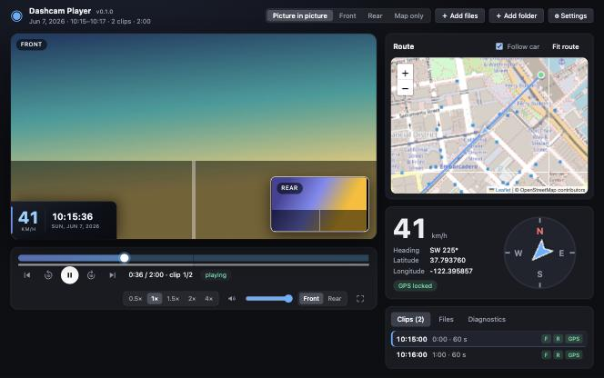
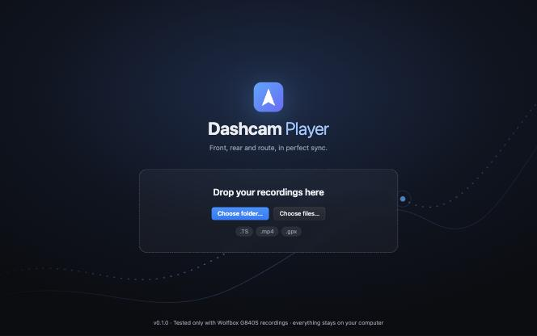
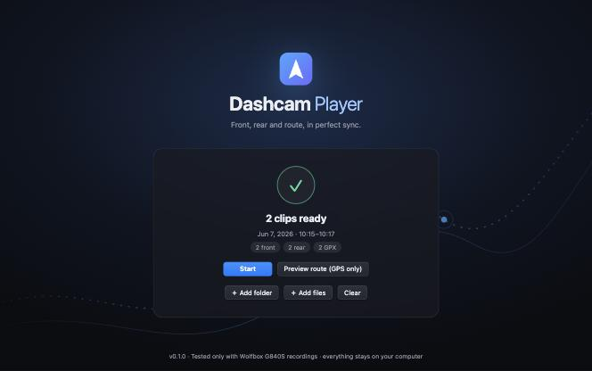
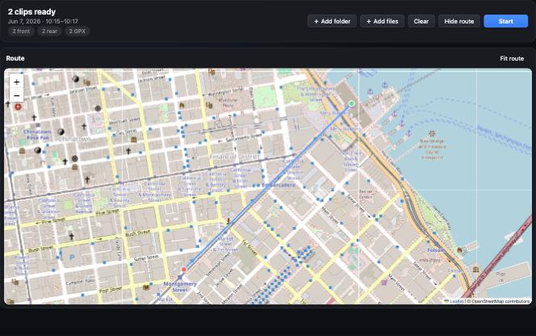
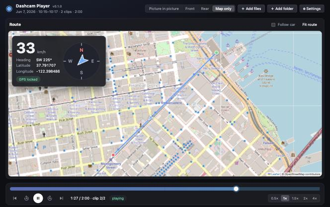
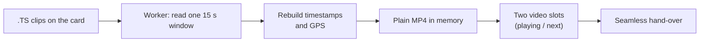

# Dashcam Player

**Turn a card full of one-minute files back into one drive.**

[](https://github.com/AshishGaur28/dashcam-player/actions/workflows/build.yml)
[](https://github.com/AshishGaur28/dashcam-player/releases)
[](LICENSE)

A Wolfbox G840S dashcam chops every drive into 60-second clips, front and rear separately, and hides the GPS inside the video stream.
Dashcam Player puts it all back together in your browser: **front and rear side by side in time, one scrubber for the whole trip, and the route
drawn on a map that follows the car**. Drop a folder in, press Start, drive again.

It is a single HTML file. No install, no account, no upload. Your recordings are only ever read, never changed, and never leave your computer.

> **Tested only with Wolfbox G840S video files.** Every format detail here (the MPEG-TS layout, the file names `FILEyymmdd-hhmmss[F|R]`,
> the embedded GPS and the transform that decodes its coordinates) was worked out from, and checked against, recordings from that one camera
> (one SD card, one trip), and the player has been tried in Chrome. Other Wolfbox models or other brands' dashcams may not play, may have no
> or wrongly placed GPS, or may show wrong speeds. **Safari has not been tested.**
>
> Not affiliated with, endorsed by or supported by Wolfbox; the name only says which camera this was made for.

<p align="center">
  
</p>

<sub>All screenshots use **synthetic demo footage and a made-up route** (nothing from a real recording).</sub>

## Try it in 30 seconds

1. Download **`DashcamPlayer-vX.Y.Z.html`** from the [Releases page](https://github.com/AshishGaur28/dashcam-player/releases) (or take `release/DashcamPlayer.html` from this repo).
2. Open it in Chrome, Edge or Safari. Only the map background needs the internet.
3. Drag in the card's `Normal` folder (or any clips, from any folders, as often as you like) and press **Start**.

Want to see where you went before anything plays? Press **Preview route (GPS only)** first: it reads only the GPS and draws the whole route.

## A quick tour

<table>
  <tr>
    <td width="50%"><br><sub><b>1. Drop in your clips</b>, from any folders, as often as you like.</sub></td>
    <td width="50%"><br><sub><b>2. Ready.</b> Press Start, or preview the route first.</sub></td>
  </tr>
  <tr>
    <td width="50%"><br><sub><b>3. Route preview.</b> Only the GPS is read: the whole trip on one map, no video opened.</sub></td>
    <td width="50%"><br><sub><b>4. Map only.</b> Play along the route with speed and heading, no video at all.</sub></td>
  </tr>
</table>

## What it can do

### 🧩 Stitch a whole trip together
- Load clips from **several folders and several drops**, in any order, and add more while playing. Front and rear are paired by file name and merged into
  **one continuous timeline**. Raw `.TS` or `.mp4`, even mixed.
- The timeline shows what is missing: a camera absent for a clip (amber hatching), footage missing between two clips (red mark), and which clips have GPS.
  Duplicates are reported and the larger file is kept.

### 🗺️ Combine the GPS of every file into one map
- Each clip's GPS is joined into **one route on one map**, with the car moving along it as you play or scrub. A hole in the GPS stays a hole: no invented lines.
- **Click any point on the route to jump the video to that moment.**
- Speed, heading (with a compass) and coordinates follow the video. Use your own `.gpx` files if you prefer (one per clip, or one for the whole trip),
  and adjust the GPS offset or speed unit (knots, m/s, km/h, mph).
- *Map only* mode plays along the route with **no video opened at all**.

### 🎬 Watch both cameras together
- Picture-in-picture with a **one-click swap** of the big and small camera, or front only, rear only. Both stay in sync (a rear offset can be set).
- A panel on the picture shows **speed, time and date**, covering the camera's own burned-in text. Switch it off any time to see the original picture.
- Click the picture to play/pause. Speed 0.5×–4×, sound from either camera, full screen, keyboard shortcuts.

### 🪶 Handle big recordings without a big footprint
- Plays straight from the files on your disk or card, in short windows, so memory stays around **100–130 MB for front and rear together**, however long the recording.
- The next part is prepared while you watch; a strip under the timeline shows what is ready. Hand-overs between parts are lined up frame by frame.
- Restarts itself if playback ever stops. A Diagnostics tab and a *Copy report* button make bug reports easy.

### 🔒 Private by design
- One HTML file, no server. Your options (speed, sound, view, GPS on/off, unit) are remembered in that browser only.

**What it is not:** an editor. It does not trim, export or convert your recordings.

## Keys

| Key | Does |
|---|---|
| `Space` | play / pause (also: click the picture) |
| `←` `→` | 5 s back / forward (`Shift`: 30 s) |
| `[` `]` | previous / next clip |
| `Home` `End` | start / end of the trip |
| `,` `.` | slower / faster |
| `↑` `↓` | volume |
| `M` | mute |
| `F` | full screen |

## The interesting bits (how it works)

**1. Browsers can't play the camera's files.** The recordings are raw MPEG-TS. So each clip is converted to a small MP4 **in memory, 15 seconds at a time, in a
Web Worker**, and played natively. The converter jumps into the middle of a file by estimating the byte position from the time, so a window costs a few
megabytes of reading, not the whole file.



**2. Safari showed sound but no picture.** The usual muxer (mux.js) writes fragmented MP4, which Chrome plays and Safari renders as black video.
`src/media/mp4File.ts` rewrites the result as an ordinary MP4 (with a real sample table), and the player falls back to streaming by itself if a browser
ever shows no picture.

**3. The GPS is hidden, and scrambled.** The camera writes `$GPRMC` sentences into a private data stream, once a second, with the coordinates run through an
obfuscating transform. The player decodes them with a transform fitted on one clip: the worst error against the official GPX is 0.08 m, and positions
match the burned-in overlay in the picture. Treat positions as inferred. The speed field is in knots, not m/s.

**4. Hand-overs are make-before-break.** Each 15-second window also holds 2.5 s of the previous one and plays 1.5 s past its end. About a second before a
window ends, the next one is lined up on the exact frame the old one will show, started at that instant, trimmed by running slightly faster or slower,
and the picture is switched only when the two agree to within about 35 ms. In Chrome it typically lines up to within a frame.

**5. It cannot get stuck.** Every wait has a time limit, a failed overlap falls back to a plain switch (and turns itself off after two failures), file reads are
retried, and playback that stops by itself restarts from where it was.

## Limits and honesty

- **Only the Wolfbox G840S has been tried**, and only with the clips from one card. The `Event` folders on that card were empty, so Event clips are untested
  (they should load if they use the same file names).
- **Safari (macOS and iOS) is untested.** The seamless hand-over, the converted MP4 and the worker are measured in Chrome only.
  If something misbehaves, open Diagnostics → *Copy report* and include it in an issue.
- Not measured: iPhone/iPad memory limits, a real 5-minute recording, a full 46-clip trip start to finish.
- A recording that reads badly from the card (junk bytes, lost packets) plays badly. This was seen once and came from how the card was mounted, not from the
  files: remount the card or copy the files off it first.
- The last clip of the sample card is unreadable (no PAT/PMT) and is skipped with a warning.

## Versions and releases

The version shows in the tool (bottom of the start page, next to the name, in Settings and in the Diagnostics report). Versions look like `v0.0.0`.

The GitHub Action in `.github/workflows/build.yml` builds `DashcamPlayer.html` **on every push** (shown as the `package.json` version plus the short commit,
for example `v0.1.0 (build 4b9350c)`) **and when a release is published**:

1. Change `"version"` in `package.json` (for example to `0.2.0`), commit and push.
2. On GitHub create a release with a new tag `v0.2.0` (it must look like `vMAJOR.MINOR.PATCH`).
3. The Action builds the file with that version and attaches `DashcamPlayer-v0.2.0.html` to the release. Every run also keeps the file as an artifact.

## Build it yourself

```bash
npm ci             # React, Leaflet, mux.js, Vite: exactly what the build needs
npm run bundle     # writes release/DashcamPlayer.html
```

```
src/recordings  file-name parsing, front/rear pairing, trip timeline
src/gps         GPX parser, camera-GPS decoder, append-only track store, speed units
src/media       TS reader/probe, window converter (worker), plain-MP4 writer, clips, PlaybackController (slots, hand-over, clock)
src/components  video panels, transport, timeline, map, telemetry, clips list, diagnostics
src/app         App, loading flow, file helpers, remembered options
scripts         bundle.mjs: inlines script, styles and worker into the one file
```

## License

MIT, see [`LICENSE`](LICENSE). The player file bundles React, Leaflet, mux.js and a few small helpers; their licenses are in
[`THIRD_PARTY_LICENSES.txt`](THIRD_PARTY_LICENSES.txt). The map background loads from OpenStreetMap's public tile server (© OpenStreetMap contributors, ODbL).
That server is meant for light use: if you host this page for many people, point the map at your own tile provider (see the OpenStreetMap tile usage policy).
